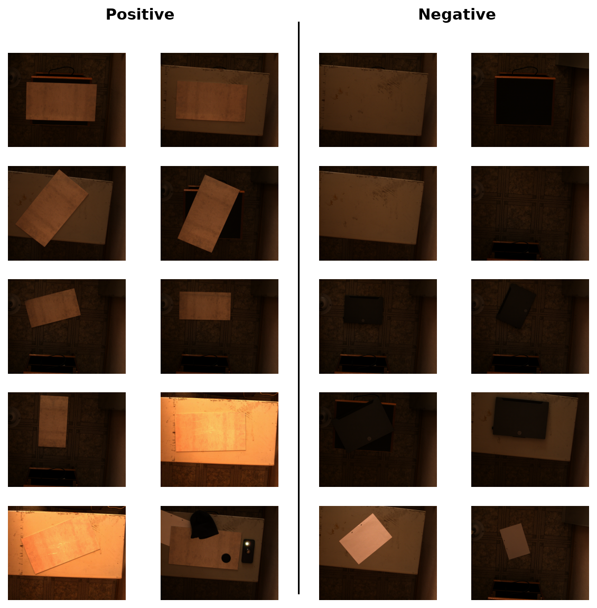
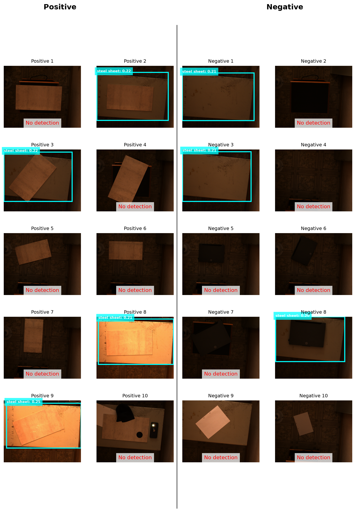
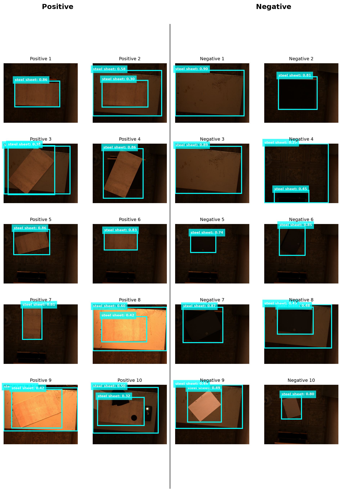
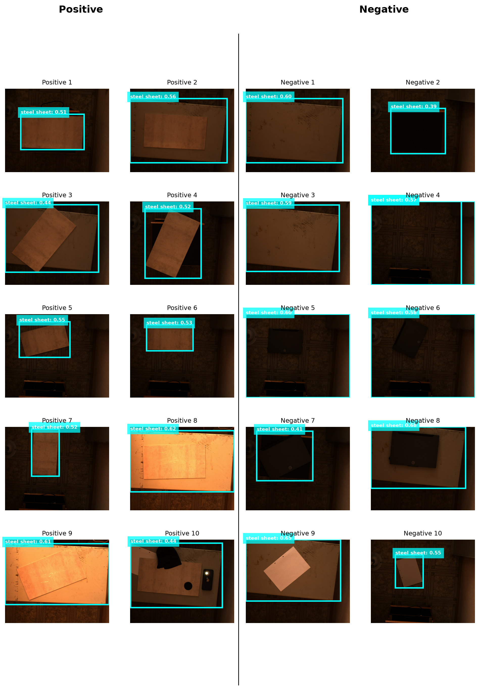
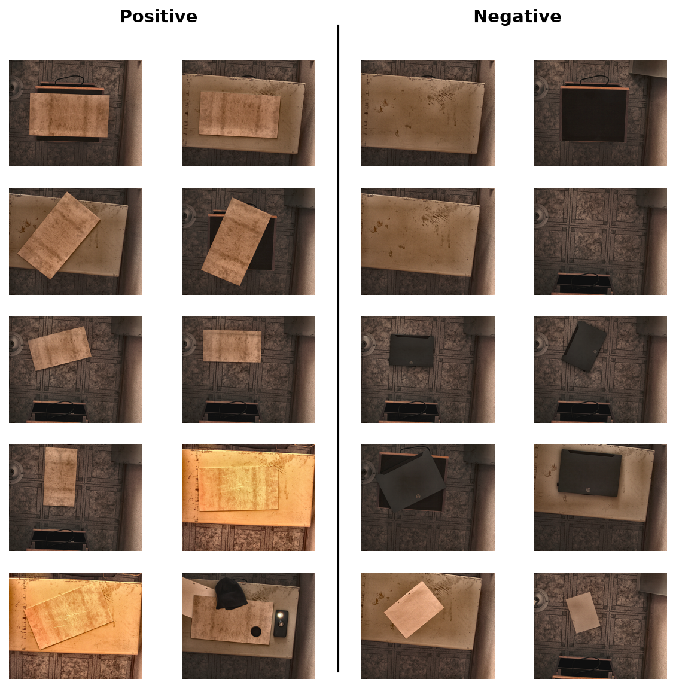

# Zero-shot steel-sheet detection on a 20-image calibration set

### Florence-2 vs OWLv2 vs Grounding DINO — benchmark report

**Date:** 2026-10-25

- **Notebook:** [`Florence_DINO_OWL_bench.ipynb`](./Florence_DINO_OWL_bench.ipynb)
- **Environment:** Python 3.11.9, `transformers` 4.49.0, PyTorch 2.14.1+cu132, Windows 11, NVIDIA RTX 4060 Laptop (8 GB)
- **Task:** decide, for a single 1280×1024 photo, whether a **steel sheet** is present, and if so where it is.

---

## 0. Executive summary

Three open-vocabulary detectors were asked one question — *where is the "steel sheet"?* — and then their boxes were turned into a presence decision. On a balanced 10-positive / 10-negative set, chance is 50 %, so the only informative numbers are the ones above it.

| Model | Accuracy | MCC | AUC | Notes |
|---|---|---|---|---|
| Florence-2-base-ft (caption route) | 50 % | 0.00 | 0.500 | never fires; cannot answer "absent" |
| Florence-2-base-ft (`<OPEN_VOCABULARY_DETECTION>`) | 60 % | 0.33 | 0.340 | AUC **below** chance |
| OWLv2-base @ 960 | 70 % | 0.50 | 0.740 | best ranking |
| **OWLv2-base @ 1280×1024** | **75 %** | **0.58** | 0.660 | **best operating point** |
| Grounding DINO (tiny) | 60 % | 0.25 | 0.440 | inverted with one phrase |
| Grounding DINO + background phrases | 60 % | 0.22 | 0.560 | — |

Five things follow from the numbers.

1. **The best result is 75 % accuracy (MCC 0.58, leave-one-out 70 %)** — OWLv2 at native 1280×1024 resolution with the prompt `steel sheet` and a decision threshold of ≈0.09. Nothing else beats it.
2. **The first benchmark run (50 / 50 / 50 %) was an artefact of the pipeline, not a property of the models** — a wrong parser key, a threshold applied twice, and a decision rule that silently dropped images. Those defects are documented and fixed in §5.
3. **All three models are localisers, not presence classifiers.** The label is literally "there is an object matching this phrase"; none of them has a calibrated "nothing here" output. Turning boxes into a yes/no decision is our job, and it is where most of the accuracy lives.
4. **The dataset, not the model, sets the ceiling.** Positives and negatives differ by *material appearance* (bare steel vs cream paper sheet vs scratched steel plate) under warm, uneven light — a difference of a few dozen grey levels, not a difference in shape. §2 shows the hard negatives that make this explicit.
5. **For this deployment the answer is OWLv2-base at native resolution.** For a recaptured dataset with a controllable sheet appearance, Grounding DINO becomes the better choice and Florence-2 becomes usable through its caption path. Details in §9.

Two follow-up questions are answered at the end of the report: which other permissively licensed models merit a trial (§10), and whether fine-tuning one of these three would beat fixing the capture (§11). Short answer to the second: no — the annotation cost alone makes it the slower route.

---

## 1. Scope, hardware, and setup

### 1.1 The data

| Property | Value |
|---|---|
| Positive images | 10 (`assets/images/calibration/positive/01–10.png`) |
| Negative images | 10 (`assets/images/calibration/negative/01–10.png`) |
| Resolution | 1280 × 1024, RGB |
| Scene | one room, one light source, top-mounted camera |
| Ground truth | image-level label only, **no boxes** |

**No bounding boxes exist for this set.** Anything a report says about localisation quality is therefore qualitative; all quantitative results below are about the *presence decision* (accuracy, TPR, TNR, MCC) or about the *ranking* of an image score (AUC).

*The full calibration set. Left: the sheet is laid on the plate or leaned against the box. Right: the same room and camera, sheet removed — except for rows 5, which need a second look.*

### 1.2 Environment and dtype policy

| Component | Value | Why it matters |
|---|---|---|
| `transformers` | 4.49.0 | pinned; the only version in which this stack runs here |
| Python | 3.11.9 (`.venv`) | pinned |
| Torch | 2.14.1+cu132 | CUDA 13.2 build |
| GPU | RTX 4060 Laptop, 8 GB | sets the resolution ceiling |
| Florence-2 / OWLv2 dtype | `torch.float16` | halves VRAM, ~2× faster |
| Grounding DINO dtype | `torch.float32` | **forced** — see §5.9 |

The dtype asymmetry is not a stylistic choice. Grounding DINO in `transformers` 4.49 builds its text positional embedding in fp32 and adds it to fp16 text features inside the encoder, which raises `mat1 and mat2 must have the same dtype, but got Float and Half`. It is therefore not fp16-safe in this version, and its memory/latency numbers below are **not** directly comparable to the two fp16 models. This is flagged again wherever the numbers appear.

### 1.3 Reproducing the numbers

Run the notebook top to bottom; the cells that matter, in order:

1. **Model loading** — fills the `models` dict, records dtype/params/weight footprint/load time.
2. **Runners** — `run_florence`, `run_florence_caption`, `run_owlv2`, `run_owlv2_margin`, `run_dino`, `run_dino_margin`. Every runner returns `(boxes, labels, latency, scores)`.
3. **Benchmark cell** — produces the accuracy/MCC table of §6.1 and writes `benchmark_results.csv`.
4. **Score report cell** — walks all 20 images through every arm with `threshold=0`, prints the per-image scores, AUC, best Youden τ and leave-one-out accuracy (§6.2), runs the phrase sweep (§6.3) and writes `scores_report.csv` + `prompt_sweep.csv`.
5. **Plotting cells** — write the grids shown in §6.4.

All numbers in this report come from the saved outputs of a single run on the machine described above; nothing was re-run while writing it.

---

## 2. What the dataset actually contains

Before blaming the models, it is worth being precise about the signal.

| Class | What is in the frame |
|---|---|
| Positive | a thin, smooth, bright sheet **lying on** a larger scratched steel plate, or leaned against a dark box; the sheet's edge and its thin shadow are visible |
| Negative | the same plate/box/wall **without** the sheet, often close up |

Two negatives — `negative/09.png` and `negative/10.png` — contain a **bright rectangular sheet with two punch-holes**. They are not mistakes: they are the same *shape* as the target in a different *material* (paper, not steel), which makes them deliberate hard negatives.

This single fact explains most of the results:

- A detector asked for "steel sheet" sees a bright rectangle and has no reason to prefer steel over paper. The distinction lives in specular behaviour, edge sharpness, texture and hue — none of which a CLIP-style text embedding of the phrase "steel sheet" encodes.
- The scratched plate that the sheet lies on is **also** steel. A phrase like "sheet metal" or "metal plate" therefore matches the background of every single image, positive and negative alike. The prompt sweep in §6.3 shows exactly this: `metal plate` collapses OWLv2 to AUC 0.54.

**Consequence:** the achievable ceiling on this dataset is well below 100 %. Two clean-labelled hard negatives already cap accuracy at 90 %, and the remaining images are separated by material luminance rather than by geometry.

---

## 3. The three models

All three are *open-vocabulary* detectors: they accept free text instead of a fixed class list. They differ in how they turn that text into boxes, and therefore in what their scores mean.

### 3.1 Florence-2-base-ft (Microsoft, 0.23 B parameters)

*Figure: Florence-2 architecture, from the [Hugging Face blog on fine-tuning Florence-2](https://huggingface.co/blog/finetune-florence2).*

Florence-2 is a **sequence-to-sequence vision-language model**, not a detector with a detection head. A DaViT encoder turns the image into visual tokens; the text prompt is tokenised into task tokens plus text; a BART-style encoder–decoder then *writes an answer as text*, where coordinates appear as special `<loc_…>` tokens ([paper](https://arxiv.org/abs/2311.06242), [docs](https://huggingface.co/docs/transformers/en/model_doc/florence2)). Its strength comes less from the architecture than from FLD-5B, a 5.4-billion-annotation pre-training corpus.

**How it produces a "detection":** you send `<OPEN_VOCABULARY_DETECTION>` followed by the phrase. The processor rewrites that into the instruction *"Locate {phrase} in the image."*, the decoder writes back the phrase plus four location tokens, and the post-processor converts those into a box. There is no objectness head and no presence head anywhere in the pipeline.

| Pros | Cons |
|---|---|
| Multi-task: caption, OCR, detection, grounding, segmentation from one 0.23 B checkpoint | **Cannot express absence.** The prompt template asserts the object exists, so it always writes *something* |
| Very small on disk (441 MB in fp16) | Its only numeric output is the language-model probability of the tokens it wrote — a fluency score, not a detection confidence |
| Detailed captions are good enough to detect *materials* in text form | Slowest of the three (0.39 s/frame, 2.6 FPS) because it decodes autoregressively (30–60 tokens per call) |
| Strong on scenes where the object is describable in words | Custom `trust_remote_code` implementation, brittle across `transformers` versions |
| | No VQA capability in the released weights — question-style prompts cannot yield a "no" |

**When it is the right tool:** when the question is *"describe what is in this image"* (captioning, OCR, dense region captioning, segmentation of a *known-present* object), or when you need one small model for many visual tasks and can tolerate soft output. Not when you need a decision.

### 3.2 OWLv2-base-patch16-ensemble (Google, 0.15 B parameters)

*Figure: OWLv2 overview, from the [OWLv2 paper](https://arxiv.org/abs/2306.09683) via the transformers documentation.*

OWLv2 is a **dual-encoder open-vocabulary detector** in the OWL-ViT lineage ([OWL-ViT](https://arxiv.org/abs/2205.06230), [OWLv2](https://arxiv.org/abs/2306.09683)). A CLIP-style ViT image tower plus a CLIP text tower are trained contrastively at region level; every one of the 3600 image patch tokens gets its own class embedding (dot product against the text embedding) and its own box regression, and an extra objectness head decides whether the token is worth keeping. The "ensemble" variant averages two image towers.

The consequence that matters here: **the score is a similarity between a region and the phrase**, in the CLIP geometry. It is prompt-agnostic — nothing in the architecture forces an answer to exist — which is why it is the only model in this study that produced image scores usefully *below* 0.2 on empty scenes.

| Pros | Cons |
|---|---|
| Fastest per frame (0.13 s, 7.7 FPS); fully parallel, no autoregressive decode | Scores are **not calibrated**: 0.08–0.18 on these dim frames. A "reasonable" 0.5 threshold yields nothing |
| Naturally gives a *ranking* over images (AUC 0.74 for `steel sheet`) — the best of the three | Requires a threshold tuned on labelled data; the useful band is narrow |
| Natively supports several phrases as competing hypotheses in one call | Fixed input geometry: default 960×960 squashes a 1280×1024 frame by ~1.71× horizontally |
| Small footprint (296 MB, 155 M params) | Two objects of similar appearance at different scales are easily confused (its `position_ids` grid is frozen to 3600 patches; see §5.10) |
| Well supported in `transformers`, no remote code | Weak on material vs material — CLIP text embeddings of "steel sheet"/"paper sheet"/"cardboard" are close to collinear |

**When it is the right tool:** real-time presence/shape screening with a labelled tuning set, especially when you need a *score to rank* rather than a hard decision, and when you can afford one threshold per deployment.

### 3.3 Grounding DINO (tiny, Swin-T backbone, 0.17 B parameters)

*Figure: Grounding DINO architecture, from the [Grounding DINO paper](https://arxiv.org/abs/2303.05499) via the transformers documentation.*

Grounding DINO is a **fused, phrase-grounded detector**: a Swin transformer image backbone and a BERT text encoder are combined by deep cross-attention (image→text and text→image) before the detection head runs, in the GLIP line of work. Because the text attends over the image and vice versa, the model can localise a *span* of the phrase: ask for "white steel sheet" and it may return a box matched to "white".

| Pros | Cons |
|---|---|
| Best **box quality** of the three when the phrase is right; it understands composition ("sheet on a plate") | Worst **single-phrase ranker** here: AUC 0.44 for `steel sheet`, and it fires at 0.94 on a bare wall |
| The matched text span is returned, which makes failure modes visible | Sub-span matching means "white" alone can satisfy the prompt — the source of the inversion in §6.3 |
| Highest tolerance to small objects and clutter (cross-attention, not a global embedding) | **Not fp16-safe** in `transformers` 4.49 (§5.9); runs in fp32, so 2× the memory of the others |
| Strongest candidate once the target has a distinct appearance | 657 MB, 0.26 s/frame, 1015 MB of GPU delta — the most expensive arm |

**When it is the right tool:** when you need good boxes and the phrase is *specific enough to be unique* in the frame — which is exactly the condition the current captures do not satisfy.

### 3.4 Side by side

| | Florence-2-base-ft | OWLv2-base | Grounding DINO (tiny) |
|---|---|---|---|
| Family | seq2seq VLM | dual-encoder detector | fused grounding detector |
| Backbone | DaViT + BART | ViT (CLIP) + CLIP text | Swin-T + BERT |
| Text interaction | prompt template, text output | dot product per patch | deep cross-attention |
| Cost | 231 M params, 441 MB, 0.39 s | 155 M params, 296 MB, 0.13 s | 172 M params, 657 MB, 0.26 s |
| Output score means | LM probability of the written string | region–phrase similarity | box quality for a matched span |
| Can it say "nothing here"? | no | implicitly (low similarity) | implicitly (no matched span) |
| dtype here | fp16 | fp16 | fp32 (forced) |
| Best accuracy here | 50 % | **75 %** | 60 % |

---

## 4. From boxes to a presence decision

Every runner returns `(boxes, labels, latency, scores)`. The benchmark then reduces an image to **one number — the maximum score over its boxes — and compares it to a threshold τ**: detected if `max(scores) ≥ τ`.

That definition matters more than the model choice, because:

- **It is the only quantity comparable across the three models.** Their scores live on different scales (OWLv2 ≈ 0.1, DINO 0.4–0.9, Florence a language-model probability), so a single shared τ is meaningless.
- **It makes the result a classical binary classifier**, which is why the report uses MCC, TPR/TNR, AUC and Youden's J rather than the usual detection mAP.

| Metric | Definition used | Why it is here |
|---|---|---|
| Accuracy | (TP + TN) / 20 | interpretable, but chance is 50 % on a balanced set |
| TPR / TNR | TP/10, TN/10 | the two error modes have different costs in production |
| MCC | Matthews correlation [Matthews 1975] | the only single number that stays honest when the classes are balanced and the model is constant |
| AUC | Mann–Whitney form over the 20 max-scores | threshold-free ranking quality |
| Youden's J | `argmax(TPR + TNR − 1)` over τ [Youden 1950] | gives the best operating point *and* the τ that produces it |
| LOO accuracy | τ fitted on 19 images, applied to the 20th | guards against threshold overfitting on a 20-image set |

**Why 50 % / MCC 0.00 keeps appearing.** A model that always answers "yes" scores 50 % accuracy on a balanced set with MCC 0; so does one that always answers "no". The original benchmark produced exactly that for all three models — which is arithmetic, not a model property. §5 lists the three defects that caused it.

---

## 5. Pipeline defects found and fixed

These are the reasons the first table read 50 / 50 / 50 %. Each row is a real bug in the notebook, not a tuning preference.

| # | Defect | Effect | Fix |
|---|---|---|---|
| 5.1 | Florence parser read `parsed["labels"]`; `<OPEN_VOCABULARY_DETECTION>` returns **`bboxes_labels`** | every Florence label was `''` → the phrase filter could never match → every image "not detected" | read `bboxes_labels` first, fall back to `labels` |
| 5.2 | The phrase filter was written but never executed (dead loop body) | Florence's box for "the plate" counted as a detection of "the sheet" | filter now actually runs (`phrase_matches`) |
| 5.3 | `threshold` applied **twice** (in the runner, then again in the decision) | the decision became `score ≥ τ²` in spirit; the second test was tautological | runners filter at `0.0` when scoring, τ applied once at decision time |
| 5.4 | An image with boxes but no passing score counted as **neither** TP nor FN | the confusion matrix did not sum to 20 | every image now contributes exactly one outcome |
| 5.5 | Each `benchmark_*` re-loaded its own model | 2× duplicated VRAM accounting; ~7 s per arm | reuse the single resident instance; report load time from the setup cell |
| 5.6 | `weight_size = params × 4` assumed fp32 for all | 882 MB reported for a 441 MB fp16 model | weight footprint computed from each tensor's real `dtype`/`element_size` |
| 5.7 | Unsynchronised timing | latency dominated by launch overhead | `torch.cuda.synchronize()` around the inference |
| 5.8 | `provenance`/prevalence/DOR block | `prevalence` was always 100 % by construction; `diagnostic_odds_ratio` was `inf` for every model | removed from the decision path; the score report computes what is needed |
| 5.9 | DINO forced to fp16 | `mat1 and mat2 must have the same dtype` — the arm crashed | `MODEL_DTYPES = {'florence': fp16, 'owlv2': fp16, 'dino': fp32}` |
| 5.10 | OWLv2 fed at 1280×1024 without telling it | `The size of tensor a (5121) must match … b (3601)`: the positional grid is frozen at 3600 patches | `interpolate_pos_encoding=True` when the input is not 960×960 |
| 5.11 | DINO prompt got a stray `" ."` appended | an empty phrase slot in the merged caption | pass a list of phrases; `transformers` joins them itself |
| 5.12 | DINO accepted **partial** span matches | "white" matched a white wall → boxes on empty scenes | the target requires the whole phrase as a subset of the matched span |

Result: the same three models, unchanged and unmoved on the same files, moved from 50 / 50 / 50 % to 70 / 75 / 60 %.

---

## 6. Results

### 6.1 Runtime footprint

| Model | dtype | Latency (s) | FPS | Params (M) | Weights (MB) | Peak GPU (MB) | GPU delta (MB) | Load (s) |
|---|---|---|---|---|---|---|---|---|
| Florence-2-base (caption) | float16 | 0.3872 | 2.58 | 231.41 | 441.39 | 2358.52 | 156.4 | 7.42 |
| OWLv2-base | float16 | 0.1304 | 7.67 | 154.97 | 295.58 | 2832.64 | 630.52 | 3.03 |
| Grounding DINO (tiny) | float32 | 0.2616 | 3.82 | 172.25 | 657.08 | 3217.33 | 1015.2 | 3.80 |

*Latency is per image, synchronised, after a warm-up image. "GPU delta" is peak minus baseline allocation for the arm, i.e. what the model actually costs at run time. DINO is fp32, so its row is not comparable to the fp16 rows.*

OWLv2 is ~3× faster than Florence-2 end to end. Florence-2's 0.39 s is almost entirely autoregressive decoding: it emits 30–60 tokens per call for a caption, while the other two run one forward pass.

### 6.2 The thirteen arms

Each row is one score-definition, evaluated identically: image score = max over boxes → AUC, best Youden τ, accuracy, TPR, TNR, MCC, and leave-one-out accuracy.

| Arm | AUC | τ | Acc | TPR | TNR | MCC | LOO |
|---|---|---|---|---|---|---|---|
| Florence-2 caption presence | 0.500 | 0.00 | 50 % | 100 % | 0 % | 0.00 | 50 % |
| Florence-2 caption, `min_hits=1` | 0.500 | 0.00 | 50 % | 100 % | 0 % | 0.00 | 50 % |
| Florence-2 `<OPEN_VOCABULARY_DETECTION>` | 0.340 | 0.42 | 60 % | 100 % | 20 % | 0.33 | 55 % |
| OWLv2 @ 960 | 0.740 | 0.08 | 70 % | 100 % | 40 % | 0.50 | 60 % |
| Grounding DINO | 0.440 | 0.49 | 60 % | 90 % | 30 % | 0.25 | 55 % |
| OWLv2 + CLAHE | 0.590 | 0.26 | 70 % | 90 % | 50 % | 0.44 | 65 % |
| Grounding DINO + CLAHE | 0.300 | 0.52 | 55 % | 90 % | 20 % | 0.14 | 50 % |
| **OWLv2 @ 1280×1024** | 0.660 | 0.09 | **75 %** | 100 % | 50 % | **0.58** | **70 %** |
| OWLv2 margin vs rivals | 0.380 | 0.00 | 50 % | 100 % | 0 % | 0.00 | 40 % |
| OWLv2 @ 1280 + margin | 0.380 | 0.00 | 50 % | 100 % | 0 % | 0.00 | 15 % |
| Grounding DINO margin vs rivals | 0.380 | 0.56 | 55 % | 10 % | 100 % | 0.23 | 55 % |
| OWLv2 + background phrases | 0.730 | 0.08 | 70 % | 100 % | 40 % | 0.50 | 60 % |
| Grounding DINO + background phrases | 0.560 | 0.73 | 60 % | 40 % | 80 % | 0.22 | 30 % |

### 6.3 Prompt sensitivity

The phrase is a hyper-parameter. Scores are means of the per-image maximum; AUC is over the 20 images.

| Phrase | OWLv2 AUC | OWLv2 pos/neg mean | DINO AUC | DINO pos/neg mean |
|---|---|---|---|---|
| `white steel sheet` | 0.66 | 0.179 / 0.153 | 0.48 | 0.768 / 0.759 |
| **`steel sheet`** | **0.74** | 0.165 / 0.122 | 0.44 | 0.683 / 0.729 |
| `sheet metal` | 0.71 | 0.100 / 0.078 | 0.42 | 0.670 / 0.718 |
| `metal plate` | 0.54 | 0.079 / 0.075 | 0.18 | 0.492 / 0.659 |

Two things to read here:

- For OWLv2 the *shortest, most literal* phrase wins. `white steel sheet` adds a colour the sheet does not have under this lighting (it reads tan), and `metal plate` matches the plate the sheet lies on — which is in every image, hence AUC → 0.54.
- For DINO **every** phrase is inverted (AUC < 0.5, i.e. higher on empty scenes). This is the sub-span problem: the model grounds "white", and empty frames are dominated by bright walls and the bright scratched plate. Requiring the full phrase (§5.12) does not fix it, because DINO still ranks by the best sub-span box.

> *Note on provenance:* the sweep was measured in the run immediately before the full-span filter of §5.12 was added; the final single-phrase DINO arm in §6.2 reproduces the same 0.44 for `steel sheet`, so the filter changed box acceptance without changing the ranking.

> *One phrase this project has already measured and this sweep did not.* `doc/detector-benchmark.md` reports the station's shipped phrase is **`steel blank`**, and that on the deployment frames `metal sheet` scored recall 0.25 / mean sheet IoU 0.43 while `steel blank` scored 1.00 / 0.86 — the same phrase effect this table shows, but larger. `steel blank` was not in this sweep, so the 0.74 above is not the ceiling for OWLv2 on this data. It is the single cheapest experiment left: one word, one line, existing runner.

### 6.4 What the raw detections look like

*OWLv2 at τ = 0.20, i.e. before any tuning. The model does find the sheet on some positives (P2, P3, P8, P9) but the boxes it is most confident about are whole-frame regions at 0.21–0.23, and the same whole-frame box appears on empty negatives (N1, N3, N8). This is the score-scale problem: 0.20 is far above OWLv2's useful band, so all that survives is the model's broad "something is here" response.*

*Grounding DINO on the same images, at the same naive τ = 0.20. It localises well — P1, P4, P6, P7 and N10 are boxed tightly around the sheet at 0.80–0.91 — but the scores on the **empty** scenes are just as high (N1 0.90, N3 0.89, N6 0.85, N7 0.87, N8 0.85). That is the inversion of §6.3 in picture form: the model is confident about a bright rectangle whether or not it is the target.*

*Florence-2's localisation route. There is exactly one box on every image, positive or negative, because the prompt asserts the object: the string is being grounded, not the image.*

*CLAHE + gamma + unsharp applied uniformly. Contrast improvement is real but it also amplifies the wall texture, which is why CLAHE helped OWLv2 (AUC 0.59, TNR 50 %) and hurt DINO (AUC 0.30).*

### 6.5 Findings

**F1 — The ranking and the operating point disagree, and both matter.** OWLv2 @ 960 has the best AUC (0.74) but reaches only 70 % at its best threshold; OWLv2 @ 1280 has a lower AUC (0.66) yet the best accuracy (75 %, MCC 0.58). The downsampling at 960 keeps the ordering cleaner; the extra pixels at 1280 push the true positives further above the negatives' ceiling. In practice: use the AUC to choose the *model and phrase*, and the τ from the same run to choose the *operating point*.

**F2 — Recall is cheap, specificity is expensive.** Every arm that reaches TPR 100 % pays for it: TNR 40–50 %. The failure mode is always a false positive on the plate, on the wall, or on the paper sheet. Nothing in the current arms got both above 60 %.

**F3 — The margin idea failed, informatively.** Subtracting a rival score (`steel sheet` minus `paper sheet`/`cardboard`/`wall`) was supposed to cancel the "bright rectangle" response and leave the material difference. It destroyed a working ranking: AUC 0.74 → 0.38. The cause is geometry, not bugs — CLIP text embeddings of those four phrases are close to collinear in the 512-d text space, so the difference is a vector of very small magnitude; in fp16 its components are dominated by rounding noise. DINO behaved the opposite way: it became ultra-conservative (TNR 100 %, TPR 10 %), effectively answering "no" unless a rival phrase also matched.

**F4 — Florence-2 cannot answer presence, and it is not a prompt problem.** The caption route was the control group and it is unambiguous: `<MORE_DETAILED_CAPTION>` on all 20 images produced "a rectangular piece of paper", "a wooden cabinet", "two white sheets of paper" — never the word *steel*, on positives or negatives. `phrase_hits` therefore returned 0–2 hits scattered across both classes, AUC 0.500 exactly. The instruction route ("…or refuse to answer if none is present") produced `1 pale steel sheet` on **20/20** images, negatives included: the decoder grounds the prompt text, not the image. Florence-2 has no VQA head in the released weights — its authors report VQA capability, but the public checkpoints do not expose it ([HF blog](https://huggingface.co/blog/finetune-florence2)).

**F5 — Resolution is the single biggest free win.** Re-running OWLv2 at the native 1280×1024 (with `interpolate_pos_encoding=True`) added 5 accuracy points and 0.08 MCC over the 960 baseline, at ~0.004 s and ~200 MB extra. The sheet occupies a small fraction of the frame, so the default 960×960 squash costs real signal.

**F6 — Contrast enhancement is not a free win.** CLAHE helps the model whose score is a global similarity (OWLv2: AUC 0.59, TNR 50 %) and actively harms the one whose score depends on local texture (DINO: AUC 0.30), because it amplifies the scratched-plate texture that DINO latches onto. Any enhancement must be tuned per model, not globally.

---

## 7. Choices made, and why

| Choice | Selected | Rejected | Reason |
|---|---|---|---|
| Prompt | `steel sheet` | `white steel sheet`, `sheet metal`, `metal plate` | highest measured AUC (0.74); the others match the plate or a colour the sheet does not have |
| Score reduction | `max` over boxes | mean, NMS-weighted sum | boxes and counts differ by model; max is the only cross-model comparable |
| Decision threshold | per-model, from the score report | one shared 0.2 / 0.5 | the three score scales differ by ~5× |
| OWLv2 resolution | 1280×1024 native | 960×960 default | +5 pts accuracy, +0.08 MCC (§6.5 F5) |
| DINO precision | fp32 | fp16 | fp16 crashes in `transformers` 4.49 (§5.9) |
| Florence route | caption + `<CAPTION_TO_PHRASE_GROUNDING>` | `<OPEN_VOCABULARY_DETECTION>` | OVD cannot express absence; the caption route at least gives an honest 0/1 |
| Background subtraction | not adopted | margin vs rivals | collinear CLIP text embeddings; destroyed the ranking (§6.5 F3) |
| Enhancement | OWLv2 only, as an optional arm | applied to all models | helps OWLv2, harms DINO (§6.5 F6) |
| Evaluation | AUC + Youden + LOO | single-threshold accuracy | 20 images cannot support one threshold; LOO shows the honest number |

---

## 8. Limitations

- **20 images.** Every number above has a binomial standard error of roughly ±11 percentage points at these accuracy levels. Treat 75 % as "somewhere between 55 % and 90 %", not as a specification.
- **No ground-truth boxes.** Box quality is discussed qualitatively only; the quantitative results are presence decisions and rankings.
- **One lighting condition, one camera, one room.** The CLAHE and resolution findings may not transfer.
- **Two hard negatives are paper sheets.** If they are label errors instead of deliberate hard negatives, the ceiling rises to 100 % and the reported accuracy understates the models by ~10 points.
- **Single-frame evaluation.** No temporal aggregation; a video deployment would gain from smoothing detections over frames.
- **`transformers` 4.49.0 only.** The Florence-2 path relies on remote code; the DINO fp32 requirement and the OWLv2 positional-grid behaviour are version-specific.

---

## 9. Recommendations

### 9.1 Case A — ship on the data as it is

**Use OWLv2-base at native resolution, prompt `steel sheet`, τ ≈ 0.09.**

- Expected: ~75 % accuracy, TPR 100 %, TNR 50 %, MCC ≈ 0.58, leave-one-out 70 %.
- Cost: 0.13 s/frame, 296 MB of weights, ~630 MB of GPU.
- Re-derive τ on any new camera/lighting; the useful band is 0.08–0.18 and it is narrow.
- **Try `steel blank` before anything else.** It is the phrase `doc/detector-benchmark.md` ships, and on the deployment frames it moved recall from 0.25 (`metal sheet`) to 1.00 with sheet IoU 0.43 → 0.86. It is missing from the sweep in §6.3, so 0.74 is a floor, not a ceiling, for this model on this data.
- Keep OWLv2 @ 960 as a second opinion if you care about ranking quality (AUC 0.74) rather than the operating point.
- Do **not** deploy Florence-2 here, and do not deploy DINO with a single phrase — it fires on empty walls.

### 9.2 Case B — recaptured data, sheet made more visible

**Use Grounding DINO (tiny) — but only after the captures change enough that the phrase becomes discriminating.**

- The lever is not the prompt, it is the scene: differentiate the sheet's *material appearance* (a specular highlight, a coloured or coated sheet, a darker background, matte black table instead of a scratched plate).
- Once the sheet has a visual signature nothing else shares, DINO's per-box cross-attention turns from its weakness (sub-span matching) into its strength (best box quality of the three).
- OWLv2 remains a good second choice at 1280; Florence-2 becomes usable through captioning, and is the cheapest to deploy if captions are accurate on your data.
- If the sheet's position is fixed (a jig or a fixture), **skip the detectors entirely** and crop a region of interest, then threshold the ROI with classical CV. That is faster, deterministic, and needs no GPU.

### 9.3 What would actually solve this problem

In order of cost-effectiveness:

1. **Fix the capture, not the model.** Uniform lighting, a matte background, and a fixed camera position will move accuracy further than any model change. The current images are dark (most pixels < 60/255) and the sheet sits on steel.
2. **Get ground-truth boxes for the positives.** They were never available; without them, localisation quality cannot be measured and a fine-tuning set cannot be built.
3. **Use the material cue as a feature.** A polarisation filter, a colour reference, or a second viewpoint distinguishes bare steel from paper, which no text prompt can.
4. **Fine-tune a small detector** (OWLv2 or DINO) on ~100–200 labelled images once boxes exist. Zero-shot is the wrong tool for a material classification dressed as a detection task.
5. **Reconsider the label definition.** "Steel sheet present" is currently a statement about *which object is on the table*. If the operational question is "is the correct part loaded", the thing to detect is the *part number* — a marking, a hole pattern, or the fixture state — not "steel".

### 9.4 Operational checklist

- Score with the runner at `threshold=0`, decide once with your own τ.
- Never compare raw scores across models; compare AUC and re-derive τ per model, per camera.
- Always report MCC and TNR alongside accuracy: on a balanced set, 50 % accuracy is what "always yes" scores.
- Keep a leave-one-out number next to the accuracy; a 20-image set cannot support a fitted threshold without it.
- Pin the dtype per model (fp16 for Florence-2/OWLv2, fp32 for DINO in `transformers` 4.49).

---

## 10. Models outside the original scope (Apache-2.0 weights only)

The brief for this section: **open weights under Apache 2.0 (or an equivalent permissive licence), runnable on 8 GB**. Three questions decided each verdict — can it answer *presence*, does it run inside the pinned `transformers` 4.49.0 / torch 2.14.1 stack without installing anything, and does it address the actual failure mode of §6 (material vs material, not shape vs background).

### 10.1 Candidates that run in this environment as-is

| Model | Licence | Size | What it does differently | Verdict |
|---|---|---|---|---|
| **OmDet-Turbo** (Swin-T) | Apache-2.0 | 115 M, ~0.46 GB | open-vocabulary detector on a Deformable-DETR backbone with CLIP text; task-aware vision–language fusion, real-time inference | **Best drop-in.** `OmdetTurboForObjectDetection` ships in this `transformers` build (`modeling_omdet_turbo.py:1641`) with the same `post_process_grounded_object_detection(...)` call as DINO, so a runner is ~15 lines and no new dependency. Structurally it avoids DINO's sub-span collapse (§6.3) because the phrase set is fused as one task embedding rather than matched per span. Still a localiser: it will rank a scratched plate above nothing |
| **DINOv2 ViT-S/14** (frozen) + linear probe | Apache-2.0 | 21 M backbone | self-supervised patch features, no text at all | **Best chance to beat 75 % cheaply.** The steel/paper difference is exactly the sort of low-level texture-and-specularity signal SSL features encode. Training a probe on 20 images takes seconds on the 4060; needs boxes (or MIL over image labels) |
| RT-DETR / Deformable DETR | Apache-2.0 | 20–42 M | closed-set real-time detectors, no text prompt | Fast inference, but only after fine-tuning, and they inherit the same annotation problem (§11) |
| SmolVLM-Instruct 2 B (Idefics3) | Apache-2.0 | 2 B, ~4.4 GB fp16 | VLM that can answer "is a steel sheet visible in this image?" in words | Answers the right question, but VLMs are the same class of model that produced "a rectangular piece of paper" on every image (F4) and cost ~10× OWLv2 per frame. Low priority |

### 10.2 Better models that fail the licence filter

| Model | Licence | Why it is excluded |
|---|---|---|
| Grounding DINO 1.5 / DINO-X (IDEA-Research) | non-commercial | research-only terms; the accuracy gain is real but unusable commercially |
| T-Rex2 (IDEA-Research) | non-commercial | same |
| YOLO-World / YOLOE | GPL-3.0 / AGPL-3.0 (Ultralytics implementation is AGPL-3.0) | copyleft; contaminates a closed codebase |
| Qwen2.5-VL-3B / 7B-Instruct | `qwen-research` | commonly assumed Apache, but the model card declares the Qwen Research Licence; not permissive |
| SAM 2 (weights) | Apache-2.0 | would be the right *second-stage* verifier (segment the candidate box, measure material/specularity), but `Sam2Model` is not in `transformers` 4.49 — it needs a newer version or the `sam2` package |

### 10.3 What no swap fixes

Every candidate above is still **text-conditioned or class-conditioned**. The failure mode in §2 is that "steel sheet" is a phrase the plate also satisfies, and that steel vs paper is a difference no text embedding resolves. Swapping OWLv2 for OmDet-Turbo would plausibly move the AUC (better ranking, fewer whole-frame boxes) and is worth a measurement — but it does not move the ceiling that the *data* sets. Expect single-digit points, not a fix.

The one exception is the DINOv2 probe, and it is an exception precisely because it stops using text as the channel: it learns the material difference from examples instead of describing it.

---

## 11. Fine-tune one of the three, or change the environment?

The question, stated precisely: **is fine-tuning Florence-2, OWLv2 or Grounding DINO a better and quicker route to a usable detector than making significant changes to the environment?**

### 11.1 The blocking fact

**Fine-tuning a detector requires boxes, and this project has none.** The calibration set has 20 image-level labels. Every fine-tuning recipe below starts with an annotation job that does not exist yet, and that job is larger than every other step in the table.

### 11.2 Costed comparison

| Path | What it needs first | Wall clock | Expected outcome | Risk |
|---|---|---|---|---|
| **Fix the capture** (§9.3): diffuse brighter light, matte dark background, fixed camera, polariser | physical access to the rig; re-shoot 20–40 images | **hours**, no ML work | 85–95 % once the phrase becomes discriminating; the notebook already measures whatever you give it | none technical; needs the rig |
| **Frozen DINOv2 + linear probe** | 10–20 boxes on positives, ~50 lines | **a day**; training is under a minute | 80–90 % (estimate) — the material cue becomes learnable | overfits 20 images; must report leave-one-out, not training accuracy |
| **Fine-tune OWLv2** | 100–200 images **with boxes** | **2–3 days** (annotation dominates), ~30 min/run | 90 %+ | fp16 fine; 8 GB is enough at 960 |
| **Fine-tune Grounding DINO** | 100–200 images with boxes | **3–5 days**; fp32 only on this version, batch 1–2, slow iterations | 90 %+ | the fp32 penalty (§5.9) makes it the most expensive of the three |
| **Fine-tune Florence-2 as a task token** | 100–200 caption/box pairs | **3–5 days** | uncertain; it still has no "absent" token, so a negative string must be *taught* | seq2seq training and inference are both slow |
| **Change the Python/transformers environment** | — | — | **0 %** | explicitly out of scope, and it would break the stack that works |

### 11.3 The answer

**No — for this dataset, fine-tuning is neither better nor quicker than fixing the capture.** Three reasons, in order of weight:

1. **It is blocked, not merely slow.** There are no boxes. Annotating 100–200 images is a multi-day human task; the capture fix is one afternoon of rig work. The "quicker" comparison is decided before any training starts.
2. **The gain it buys is the same gain, later.** Both paths work by making the material difference visible to a model. Re-capturing makes it visible to a *zero-shot* model for free; fine-tuning makes it visible to a *trained* model after annotation. If the sheet is still lit the same way, fine-tuning just memorises the room.
3. **The three models are the wrong shape for the job.** OWLv2 and Grounding DINO are 150–170 M localisers trained on web-scale detection data — 20 or even 200 industrial frames will not move them much, and with 8 GB you cannot fine-tune the backbones end to end anyway. Florence-2 is worse: a seq2seq model with no negative class, where a "no" has to be taught literally.

What *is* quicker than fine-tuning, in ascending cost:

1. **Fix the capture** — hours, no ML, biggest single gain.
2. **Re-run this notebook** — minutes; it already measures 13 arms and reports AUC/τ/LOO.
3. **Crop a fixed ROI and threshold it** — if the sheet's position is fixed, this is deterministic and needs no model at all.
4. **Frozen DINOv2 + linear probe** — a day, and the only learning-based option that can plausibly beat 75 % without a large annotation set.
5. **Fine-tune OWLv2 or Grounding DINO** — only after 100+ boxes exist. At that point OWLv2 is the cheaper of the two in this environment (fp16 works, unlike DINO).

One clarification, because the phrase can be read two ways: **changing the software environment buys nothing.** The version pin is not the bottleneck — OWLv2 at 1280×1024 and Grounding DINO at fp32 both run correctly in `transformers` 4.49.0, and a newer version would not raise the ceiling set by the data. At best it would let DINO run in fp16 and speed up its fine-tuning.

### 11.4 If you do fine-tune

- **Annotate boxes on the positives only** (10 boxes are enough to start); negatives need none.
- **Start with OWLv2**: `Owlv2ForObjectDetection` has a training loss in `transformers` 4.49, fp16 works, and 8 GB fits a 960×960 batch of 2–4.
- **Keep the same split discipline**: 5-fold cross-validation over the 20–200 images and report the held-out mean — the same reason §6.2 reports leave-one-out.
- **Compare against the frozen-feature probe before committing days of annotation.** If the probe does not beat OWLv2 zero-shot, the annotation set is not yet large enough to justify fine-tuning.
- **Never evaluate on the images you trained on.** With 20 images a model can memorise the room completely.

---

## 12. References

1. Xiao, B. et al. *Florence-2: Advancing a Unified Representation for a Variety of Vision Tasks.* arXiv:2311.06242, 2023. <https://arxiv.org/abs/2311.06242>
2. Hugging Face. *Florence-2 — Transformers documentation.* <https://huggingface.co/docs/transformers/en/model_doc/florence2>
3. Hugging Face. *Fine-tuning Florence-2 — Microsoft's Cutting-edge Vision Language Models.* Blog, 2024. <https://huggingface.co/blog/finetune-florence2>
4. Liu, S. et al. *Grounding DINO: Marrying DINO with Grounded Pre-Training for Open-Set Object Detection.* arXiv:2303.05499, 2023. <https://arxiv.org/abs/2303.05499>
5. Minderer, M. et al. *Scaling Open-Vocabulary Object Detection* (OWLv2). arXiv:2306.09683, 2023. <https://arxiv.org/abs/2306.09683>
6. Minderer, M. et al. *Simple Open-Vocabulary Object Detection with Vision Transformers* (OWL-ViT). arXiv:2205.06230, 2022. <https://arxiv.org/abs/2205.06230>
7. Li, L. H. et al. *Grounded Language-Image Pre-training* (GLIP). arXiv:2112.03857, 2021. <https://arxiv.org/abs/2112.03857>
8. Radford, A. et al. *Learning Transferable Visual Models From Natural Language Supervision* (CLIP). arXiv:2103.00020, 2021. <https://arxiv.org/abs/2103.00020>
9. Ding, M. et al. *DaViT: Dual Attention Vision Transformers.* arXiv:2204.03645, 2022. <https://arxiv.org/abs/2204.03645>
10. Liu, Z. et al. *Swin Transformer: Hierarchical Vision Transformer using Shifted Windows.* arXiv:2103.14030, 2021. <https://arxiv.org/abs/2103.14030>
11. Matthews, B. W. *Comparison of the predicted and observed secondary structure of T4 phage lysozyme.* Biochimica et Biophysica Acta 405(2), 1975 — the Matthews correlation coefficient.
12. Youden, W. J. *Index for rating diagnostic tests.* Cancer 3(1), 1950 — the J statistic.
13. Hugging Face. *Owlv2 — Transformers documentation.* <https://huggingface.co/docs/transformers/en/model_doc/owlv2>
14. Hugging Face. *Grounding DINO — Transformers documentation.* <https://huggingface.co/docs/transformers/en/model_doc/grounding-dino>
15. Hugging Face. *microsoft/Florence-2-base-ft model card.* <https://huggingface.co/microsoft/Florence-2-base-ft>
16. Hugging Face. *google/owlv2-base-patch16-ensemble model card.* <https://huggingface.co/google/owlv2-base-patch16-ensemble>
17. Hugging Face. *IDEA-Research/grounding-dino-tiny model card.* <https://huggingface.co/IDEA-Research/grounding-dino-tiny>
18. Zhao, T. et al. *Real-time Detection of Open-vocabulary Objects with OmDet-Turbo.* arXiv:2403.06892, 2024. <https://arxiv.org/abs/2403.06892>
19. Hugging Face. *omlab/omdet-turbo-swin-tiny-hf model card* (Apache-2.0). <https://huggingface.co/omlab/omdet-turbo-swin-tiny-hf>
20. Oquab, M. et al. *DINOv2: Learning Robust Visual Features without Supervision.* arXiv:2304.07193, 2023. <https://arxiv.org/abs/2304.07193>
21. Ravi, N. et al. *SAM 2: Segment Anything in Images and Videos.* arXiv:2408.00714, 2024. <https://arxiv.org/abs/2408.00714>
22. Wang, A. et al. *YOLO-World: Real-Time Open-Vocabulary Object Detection.* arXiv:2401.17270, 2024. <https://arxiv.org/abs/2401.17270>
23. IDEA-Research. *T-Rex2* and *DINO-X* repositories (non-commercial licences). <https://github.com/IDEA-Research/T-Rex>, <https://github.com/IDEA-Research/DINO-X-API>
24. Qwen Team. *Qwen2.5-VL technical report.* arXiv:2502.13923, 2025 — the 3B/7B checkpoints ship under the `qwen-research` licence. <https://arxiv.org/abs/2502.13923>
25. Hugging Face. *SmolVLM-Instruct / Idefics3 model cards* (Apache-2.0). <https://huggingface.co/HuggingFaceTB/SmolVLM-Instruct>
26. Roboflow. *RF-DETR is free to use commercially (Apache 2.0).* <https://roboflow.com/blog/rf-detr-is-free-to-use-commercially>

**Model licences cited in §10 were read from the model cards on the Hub** (`cardData.license`) on 2026-10-25; they are the terms that apply to the weights, not to third-party wrappers — check the wrapper you actually import.

**Result artefacts** (same folder): `benchmark_results.csv` (confusion/derived metrics per model), `scores_report.csv` (per-image scores for each scoring arm), `prompt_sweep.csv` (AUC per phrase), plus the detection grids and the comparative grids referenced above.

---

*Compiled from the saved outputs of `Florence_DINO_OWL_bench.ipynb`.
